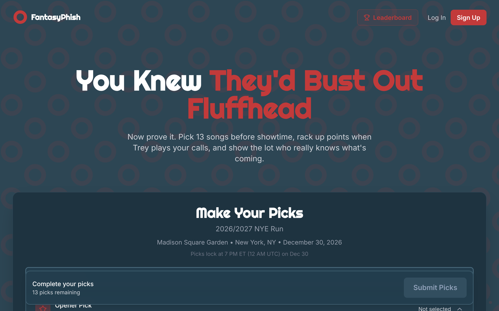
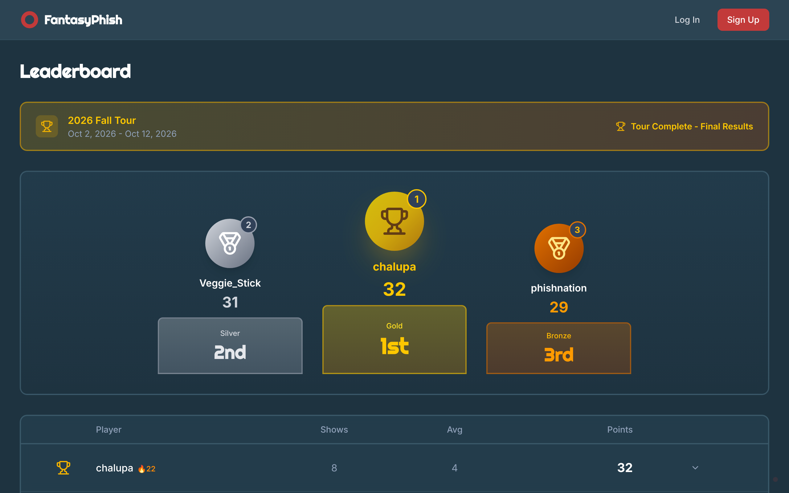
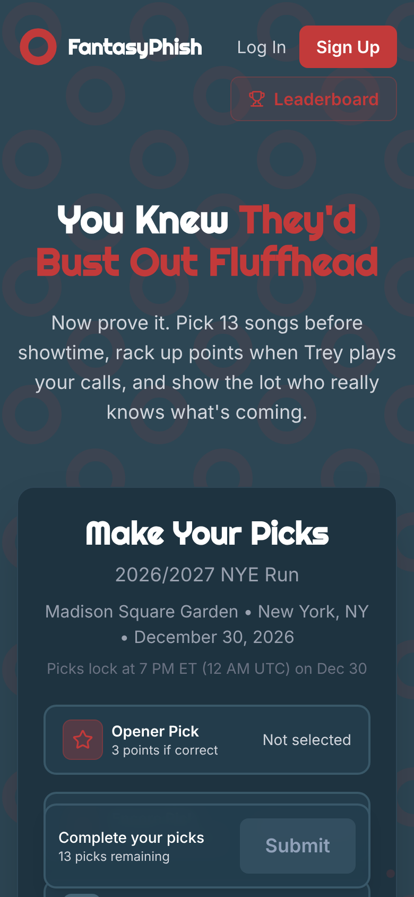
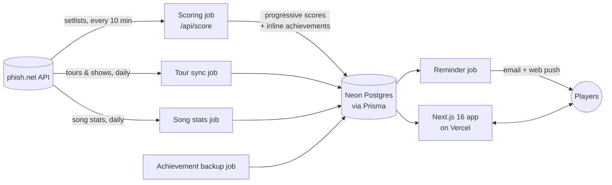

<div align="center">


# FantasyPhish

**You knew they'd bust out Fluffhead. Now prove it.**

Fantasy sports for Phish fans: pick 13 songs before each show, score points live as the band plays them, and climb the tour leaderboard.

### [▶ Play at fantasyphish.com](https://www.fantasyphish.com)

[](https://github.com/CaseyKelly/fantasyphish/actions/workflows/e2e-tests.yml)
[](https://github.com/CaseyKelly/fantasyphish/actions/workflows/unit-tests.yml)
[](https://codecov.io/gh/CaseyKelly/fantasyphish)


[](LICENSE)



</div>

## How it works

1. **Make your picks.** Before each show, choose an opener for each set, an encore, and regular songs to fill out 13 picks from Phish's catalog. You can see how long it's been since each song was played.
2. **Picks lock at 7 PM venue time.** That's 7 PM wherever the show is, whether it's Madison Square Garden or the Gorge.
3. **Watch the points roll in.** Scores update live during the show as the setlist comes in from [phish.net](https://phish.net).
4. **Climb the leaderboard.** Every tour has its own standings, with a podium for the top three.

| Pick                                             | Points |
| ------------------------------------------------ | ------ |
| Set opener (first song of each set, one per set) | 3 each |
| Encore (any song in the encore)                  | 3      |
| Regular (rest of the 13 picks, played anywhere)  | 1 each |

Admins mark each show as 1, 2 (the default) or 3 sets, which sets how many opener picks it gets. Regular picks fill out the 13, so a perfect show is worth **17 / 19 / 21 points** for 1 / 2 / 3 sets.

<table>
  <tr>
    <td width="66%"></td>
    <td width="34%"></td>
  </tr>
  <tr>
    <td align="center"><sub>Tour leaderboard</sub></td>
    <td align="center"><sub>Built for the lot: mobile-first, installable PWA</sub></td>
  </tr>
</table>

## Features

- 🎯 **Live, progressive scoring.** A scheduled job re-scores every submission every 10 minutes during a show.
- 🕖 **Locking by time zone.** Each show locks at 7 PM in the venue's own time zone, with a fallback that checks whether the setlist has already started.
- 🏆 **Tour leaderboards** with podiums, averages and pick streaks.
- 🍩 **Achievements with deep cuts:**
  - **Helping Friendly Book:** summon Icculus by turning on notifications
  - **Jackpot:** pick Harpua and have it played
  - **Couch Tour → Tour Rat → Lot Lifer → Never Miss a Sunday Show:** pick streaks of 5, 10, 25 and 50 shows
  - **Donut Devotee:** catch 20 donuts in the hidden Donut Catch mini-game
  - **Sample in a Jar:** vote in a site poll
  - …and more
- 🔔 **Reminders** by email and web push at noon Mountain time on show days, sent only if you haven't picked yet.
- 📱 **Installable PWA** with a service worker, so it works like an app on your phone.
- 🗳️ **Polls**, user profiles, and admin tools for impersonating users and resetting shows.

## Under the hood



### Problems that turned out to be interesting

- **"When does the show start?"** Picks lock at 7 PM in the venue's time zone. `src/lib/timezone.ts` maps each venue's state or province to an IANA time zone and works out the exact lock time, daylight saving included. Vercel's scheduled jobs only run on fixed UTC times, so the reminder job is scheduled twice a day and only the run that lands at noon Mountain actually sends.
- **When is a show over?** The setlist arrives song by song. If a show were marked complete as soon as an encore appeared, a double encore would be scored wrong. So the scoring job tracks when the encore started and how many songs it has. It waits 60 minutes after the last encore song, and restarts that wait whenever a new encore song shows up.
- **Matching song names.** "Down with Disease" vs. "Down With Disease" vs. "Down with Disease " all count as the same song. Every comparison goes through one shared normalization function.
- **Awarding achievements twice, safely.** Achievements are awarded during scoring as soon as they're earned. A daily backup job awards anything that was missed. Both paths are idempotent, so running them twice never awards anything twice.
- **Preview deploys never touch production data.** Each pull request gets its own Neon database branch. The build applies migrations to that branch's database, and if the preview's database turns out to be production, it skips migrations instead of applying unmerged ones (`src/lib/migration-url.ts`). A stuck migration lock is recovered automatically during the build.
- **Retrying database calls.** Database calls in scheduled jobs go through `withRetry()`, which retries temporary connection errors with exponential backoff.

### Tech stack

| Layer          | Tools                                                                                                                 |
| -------------- | --------------------------------------------------------------------------------------------------------------------- |
| App            | Next.js 16 (App Router), React 19, TypeScript (strict), Tailwind CSS v4                                               |
| Data           | Prisma 7, Neon Postgres (with per-PR database branches)                                                               |
| Auth           | NextAuth.js v5 (credentials + email verification)                                                                     |
| Notifications  | Resend (email), Web Push, Serwist service worker                                                                      |
| Infrastructure | Vercel (hosting + scheduled jobs), Sentry, Vercel Analytics & Speed Insights                                          |
| Quality        | Vitest unit tests, Playwright E2E tests (4 parallel workers) with axe accessibility checks, CodeQL, Codecov, Renovate |
| Data source    | [phish.net API v5](https://phish.net/api)                                                                             |

## Running it locally

### Prerequisites

- [mise](https://mise.jdx.dev), which installs the exact Node version pinned in `mise.toml` (Node 24)
- A PostgreSQL database (a [Neon](https://neon.tech) branch works well)
- A [phish.net API key](https://phish.net/api) and a [Resend](https://resend.com) API key

### Environment variables

Create a `.env` file **before** running any database commands. Without one, Prisma falls back to a local `postgresql://localhost:5432/fantasyphish` database:

```bash
DATABASE_URL="postgres://..."         # pooled connection
DIRECT_URL="postgres://..."           # direct connection (used for migrations)
AUTH_SECRET=""                        # openssl rand -base64 32
NEXTAUTH_URL="http://localhost:3000"
NEXT_PUBLIC_APP_URL="http://localhost:3000"
PHISHNET_API_KEY=""
RESEND_API_KEY=""
CRON_SECRET=""                        # optional locally
PRIVATE_VIEWER_EMAIL=""               # account allowed to view owner-only pages
```

### Setup

```bash
mise install                  # install the pinned Node version
mise exec -- npm install      # install dependencies with that Node

npm run db:migrate            # apply Prisma migrations
npm run db:seed               # seed the song catalog from phish.net
npm run db:sync-tours 2026    # optional: sync tours/shows for a year

npm run dev                   # http://localhost:3000
```

To make yourself an admin:

```sql
UPDATE "User" SET "isAdmin" = true WHERE email = 'you@example.com';
```

### Useful commands

| Command                 | What it does                                 |
| ----------------------- | -------------------------------------------- |
| `npm run test:unit`     | Vitest unit tests                            |
| `npm test`              | Playwright E2E tests                         |
| `npm run lint`          | ESLint (zero warnings allowed)               |
| `npm run typecheck`     | TypeScript type check                        |
| `npm run watch:scoring` | Watch the scoring job locally                |
| `npm run db:branch`     | Create, reset or list Neon database branches |

## Deployment

The app is deployed on Vercel. Pushing to `main` deploys production, and every pull request gets its own preview deploy and database branch. The `build` script runs `prisma migrate deploy` automatically, so schema changes ship with the code and no manual database steps are needed.

Scheduled jobs (`vercel.json`). Each one returns early unless at least one tour has status `ACTIVE`; tours that are only upcoming (`FUTURE`) don't turn them on. The one exception is the achievements job: before that check, it backfills the notification, poll and streak achievements, so those still get awarded between tours.

| Job                       | Schedule (UTC)                                                           |
| ------------------------- | ------------------------------------------------------------------------ |
| `/api/score`              | Every 10 minutes                                                         |
| `/api/sync-tours`         | Daily at 06:00                                                           |
| `/api/sync-song-stats`    | Daily at 07:00                                                           |
| `/api/award-achievements` | Daily at 08:00                                                           |
| `/api/send-reminders`     | Daily at 18:00 and 19:00 (noon Mountain, either side of daylight saving) |

## Documentation

- [Scoring guide](docs/SCORING_GUIDE.md): how scoring works
- [Scheduled jobs](docs/CRON_JOBS.md): job configuration and monitoring
- [Monitoring guide](docs/MONITORING_GUIDE.md): debugging the scoring job
- [Custom tours](docs/CUSTOM_TOURS.md)
- [Local database setup](docs/LOCAL_DATABASE_SETUP.md)
- [AGENTS.md](AGENTS.md) / [CLAUDE.md](CLAUDE.md): guidelines for AI coding agents

## License

[MIT](LICENSE). Setlist data courtesy of [phish.net](https://phish.net). This is a fan project and is not affiliated with Phish.
